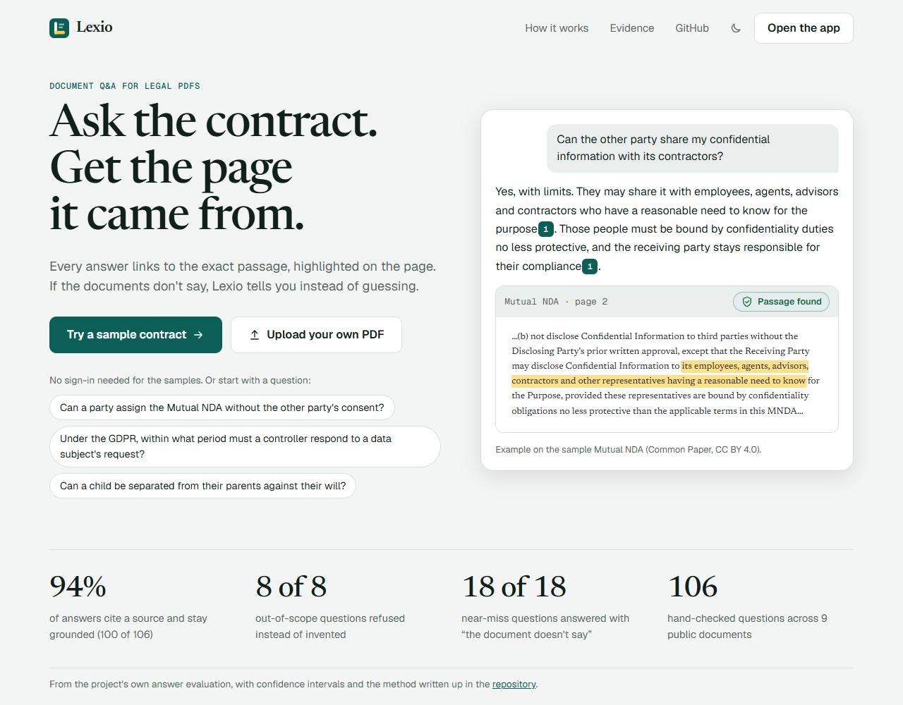
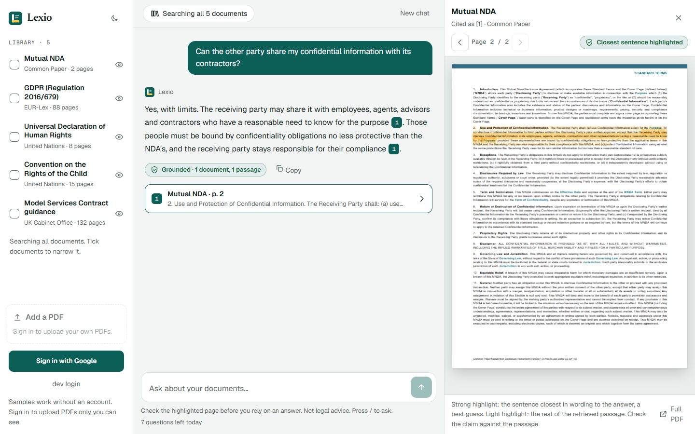

# Lexio

**Ask the contract. Get the page it came from.**

Lexio answers questions about legal PDFs and cites the exact page for every claim. Hover a citation to see the passage, click it to open the page with the text highlighted. When the documents don't contain the answer, it says so instead of guessing.

**[Live demo](https://ask-lexio.vercel.app)** (the sample documents need no sign-in) · [Evaluation results](docs/evaluation.md) · [API](docs/api.md) · [Deploy it yourself](DEPLOY.md)



## What it does

- **Cited answers.** Every claim carries a numbered citation that links to one page of the source PDF. The page opens next to the chat with the retrieved passage highlighted, and the sentence closest to the claim marked more strongly.
- **Honest refusals.** If the best match is too weak, or the document gives no such detail, the answer says so and is labelled "Not found in the selected documents".
- **Your own PDFs.** Sign in with Google to upload documents that only you can see. Anonymous visitors can ask about the shared samples.
- **Measured, not claimed.** There is an evaluation set with verified gold pages, and the results are published with confidence intervals, including where retrieval fails.
- **Accessible and responsive.** Keyboard operable, announces answers to screen readers once instead of token by token, follows the system light or dark theme, and works on phones.



## How it works

```text
PDF ──► pypdf ──► page-bounded chunks ──► embeddings ──► Postgres (pgvector HNSW + tsvector GIN)
                                                                │
question ──► embed ──┬─► vector top-30 ──┐                      │
                     └─► keyword top-30 ─┴─► RRF fusion ──► top-6 ──► LLM (streamed, cited)
```

| Layer | Choice | Why |
| --- | --- | --- |
| Web | Next.js 16, React 19, Auth.js, pdf.js | Streaming chat, Google sign-in, and a page viewer that can highlight text |
| API | FastAPI, async psycopg 3, Server-Sent Events | Deploys on Vercel with zero config |
| Storage | Postgres + pgvector (Neon in production); users' PDFs in Vercel Blob when deployed | One database for vectors, full-text search and metadata |
| Retrieval | Cosine similarity plus Postgres full-text, fused with Reciprocal Rank Fusion | Keyword search catches exact terms; vectors catch paraphrases |
| Embeddings | `gemini-embedding-2` at 768 dimensions (free tier); `bge-base-en-v1.5` locally | Same 768-dimension column for both |
| LLM | `openai/gpt-oss-120b` on Groq | Free tier, reasoning kept out of the answer text |
| Chunking | Per page, about 1,200 characters, 150 overlap, never crossing a page | Every citation points at exactly one page |

Chunks and citations are the product. If the best chunk's similarity is below the refusal threshold, `/api/chat` refuses instead of guessing.

## Results at a glance

Measured with Gemini embeddings and Groq answers on nine public documents (five standard contract templates), using questions with a verified gold page each:

| Check | Result |
| --- | --- |
| Answer cites a source and is grounded | 94% (100 of 106) |
| A cited source is on the gold page | 93% (99 of 106) |
| Out-of-scope questions refused | 8 of 8 |
| Near-miss questions answered honestly ("not specified") | 18 of 18 |
| Follow-ups found after rewriting with the conversation | 11 of 11 (7 of 11 without the rewrite) |
| Planted instruction inside a document obeyed | no (one case) |

These are regression checks on a small set, not proof of accuracy on real contracts. Perfect scores on 8 or 18 cases are consistent with true rates as low as 68% and 82%. The 95% confidence intervals, the retrieval comparisons (vector, keyword, hybrid) and what did and did not work are in [docs/evaluation.md](docs/evaluation.md).

## Quick start

You need Docker, [uv](https://docs.astral.sh/uv/) and Node.js.

```bash
docker compose up -d db
cp .env.example .env          # add GROQ_API_KEY and GEMINI_API_KEY, plus API_TOKEN_SECRET (32+ characters)
cd backend
uv sync --group dev
uv run uvicorn app.main:app --reload
```

On Windows keep `--reload`: without it uvicorn uses an event loop that psycopg's async mode cannot run on, and every database call times out. API documentation is served at `http://localhost:8000/docs`.

In a second terminal:

```bash
cd frontend
cp .env.example .env.local    # API URL and the sign-in secrets
npm install
npm run dev                   # http://localhost:3000
```

Load the sample documents into your local database without spending any embedding quota:

```bash
cd backend
uv run --group local-embeddings python -m evals.seed --provider local
```

Sign in with Google, or use the dev login that `npm run dev` offers (it exists only in development builds). Setup details for sign-in and limits are in [docs/operations.md](docs/operations.md).

Run the tests:

```bash
cd backend && uv run pytest && uv run ruff check .      # unit and end-to-end tests against local Postgres, no API keys needed
cd frontend && npm test && npm run typecheck             # stream parser, citation and highlight tests
```

## Documentation

| Document | What is in it |
| --- | --- |
| [docs/evaluation.md](docs/evaluation.md) | The question set, retrieval and answer results with confidence intervals, and how to reproduce them |
| [docs/operations.md](docs/operations.md) | Free-tier limits, accounts and per-user documents, the demo limits, and optional tracing |
| [docs/api.md](docs/api.md) | The HTTP API and its errors |
| [DEPLOY.md](DEPLOY.md) | Deploying to Vercel, Neon and Blob step by step |
| [data/samples/NOTICE.md](data/samples/NOTICE.md) | Sources and licences of the sample documents |

## Known limitations

- No OCR: scanned PDFs are rejected, not read.
- Follow-ups work by rewriting the latest message into a standalone question with the LLM. There is no other conversation memory, and a failed rewrite falls back to searching the raw message.
- The evaluation set is small (106 answerable questions over nine documents). Read the confidence intervals.
- The highlighted sentence is the passage sentence closest in wording to the answer, not what the model actually read. On 36 checked questions it contained the expected evidence about 9 times in 10, so the surrounding passage is marked too.
- Free-tier quotas limit uploads, evaluations and how many questions a public demo can answer per day. The budget guard keeps a deployment inside them; it does not raise them.
- Prompt-injection defences (documents are fenced as untrusted data, and the prompt says never to obey them) reduce the risk but cannot remove it.
- Anonymous limits count a hashed IP address, which people behind one shared address share. A determined person can make several Google accounts; only the global daily caps stop that.
- The real Google sign-in is checked by hand, not in automated tests. The deployment guide has been followed once on real services; the items not yet confirmed on the live site are listed in [DEPLOY.md](DEPLOY.md).

## Status

Working end to end: retrieval and citations, streaming chat, the page viewer, Google sign-in with per-user documents and limits, direct-to-Blob uploads, optional Langfuse tracing, and scheduled evaluations in CI. The original Streamlit, FAISS and Ollama prototype is preserved at [commit `38f8892`](https://github.com/rumanmlk/Lexio/tree/38f8892).

Issues and pull requests are welcome. See [CONTRIBUTING.md](CONTRIBUTING.md) for the checks to run first, [SECURITY.md](SECURITY.md) to report a vulnerability privately, and the [Code of Conduct](CODE_OF_CONDUCT.md).

Not legal advice. Released under the [MIT licence](LICENSE).
